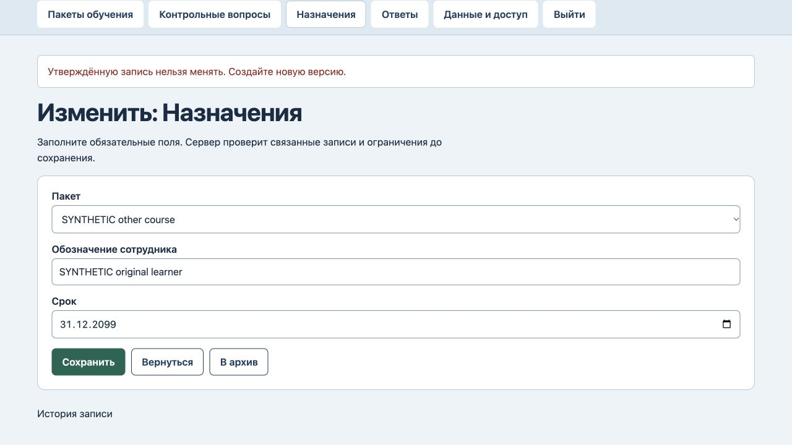
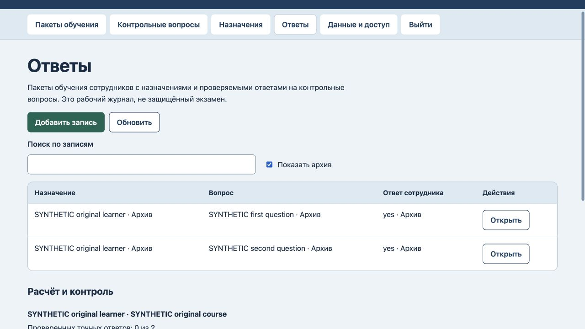

# BranchLearn: сохранение связей исторических ответов

25 октября 2026. На прежнем коде воспроизведены смена сотрудника у назначения с ответом, перенос записанного ответа к другому назначению и смена пакета после архивирования ответов. Последнее оставляло архивный ответ связанным с вопросом из другого пакета. Три новые регрессии сначала завершились ошибкой. Защита текста и эталона вопроса при архивном ответе уже работала и сохранена.

Теперь записанный ответ сохраняет назначение и вопрос. Наличие любого ответа, включая архивный, защищает пакет и сотрудника назначения. Для другого сотрудника или пакета нужно создать отдельное назначение. Текст неархивного ответа можно исправить с записью в журнале; архивирование и новая попытка остаются явными действиями. Срок назначения редактируется, назначение без ответов можно перенести.

Прошли 7 тестов: сохранность данных и журнала при отказах, положительные исправления и повторная попытка, файловый перезапуск, восстановление в пустую базу. Старая архивная несогласованность в отдельной синтетической копии восстанавливается без автоматического исправления и не блокирует несвязанные записи.

В браузере перенос ответа и смена сотрудника отклонены без изменения всех данных, версии 9 и журнала 9. После явного архивирования второго ответа перенос назначения в другой пакет также отклонён: оба ответа архивны, исходные связи сохранены, версия 10 и журнал 10. Изменение срока и перенос пустого назначения разрешены: версия 12 и журнал 12. После перезагрузки через «Показать архив» прочитаны оба прежних ответа с исходным сотрудником, вопросами и текстом. [Машинная проверка](history-verification.json).

Это журнал самопроверки с доступным команде ключом, не защищённый экзамен и не доказательство освоения навыка. Полные неизменные снимки учебного материала, внешние LMS и промышленное размещение не добавлялись. Старые ошибочные связи требуют отдельной ручной сверки. Разметка и схема хранения без изменений; новый полный аудит интерфейса и безопасности не проводился.
